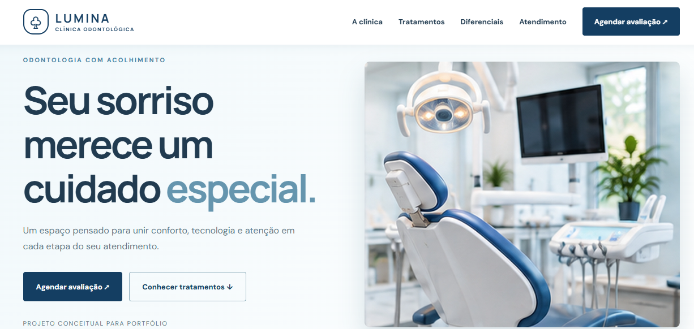
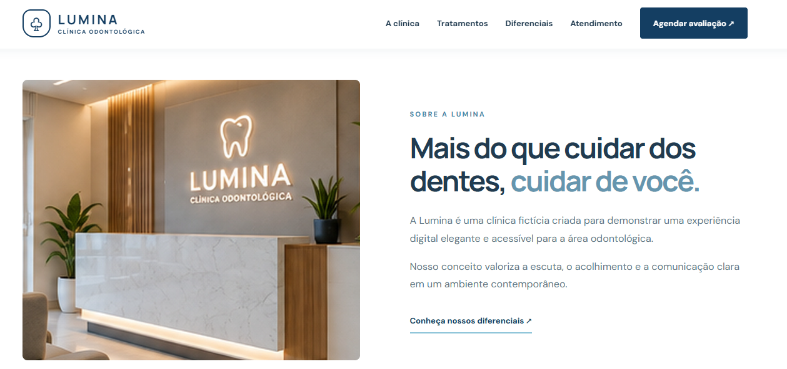
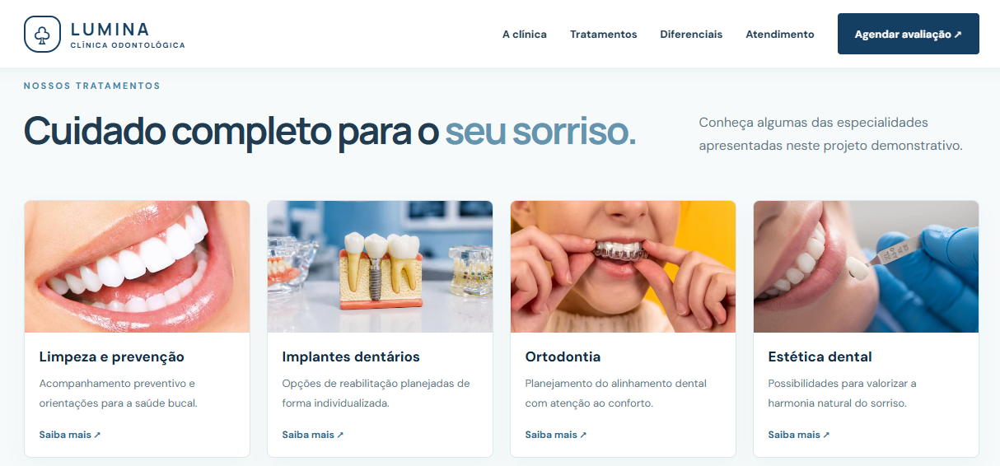
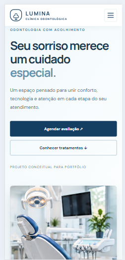

# Clínica Odontológica Lumina

Site institucional **fictício e demonstrativo** para uma clínica odontológica, desenvolvido para portfólio com HTML, CSS e JavaScript.

## 🌐 Projeto online

Acesse o site publicado:

https://jefersonalvesrs.github.io/clinica-lumina/

## ✨ Funcionalidades

- Layout responsivo para computador, tablet e celular
- Menu mobile funcional
- Seções de apresentação, tratamentos, diferenciais e etapas do atendimento
- Formulário demonstrativo que prepara mensagem para WhatsApp
- Botões de início e voltar ao topo
- Imagens ilustrativas locais em `assets/images`
- Sem backend e sem envio de dados a servidor

## 🛠️ Tecnologias

- HTML5
- CSS3
- JavaScript (sem frameworks)

## 📁 Estrutura

```text
clinica-lumina/
├── index.html
├── style.css
├── script.js
├── assets/
│   └── images/
│       ├── hero.jpg
│       ├── sobre.jpg
│       ├── sorriso.jpg
│       ├── implantes.jpg
│       ├── ortodontia.jpg
│       ├── estetica.jpg
│       ├── atendimento.jpg
│       └── favicon.svg
├── imagens/
│   ├── screenshot-home.jpg
│   ├── screenshot-sobre.jpg
│   ├── screenshot-tratamentos.jpg
│   └── screenshot-mobile.jpg
└── README.md
```

## ▶️ Como executar

Abra o arquivo `index.html` no navegador ou utilize a extensão Live Server no VS Code.

## 💬 WhatsApp

O formulário não abre o WhatsApp enquanto `WHATSAPP_NUMBER` estiver vazio.

Para ativar a funcionalidade, configure um número autorizado no arquivo `script.js`, utilizando o formato internacional, apenas com dígitos.

## 📸 Capturas de tela

### Página inicial



### Sobre a clínica



### Tratamentos



### Versão mobile



## ⚠️ Aviso

**Projeto conceitual.** A Clínica Lumina, sua equipe, seus serviços e seu atendimento são fictícios. O site utiliza imagens ilustrativas, incluindo imagens geradas por inteligência artificial e fotografias de referência. As imagens não documentam atendimentos ou tratamentos realizados pela clínica. Não há atividade comercial real.